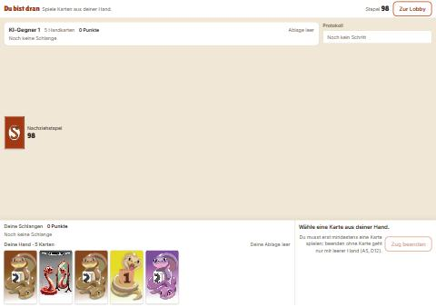
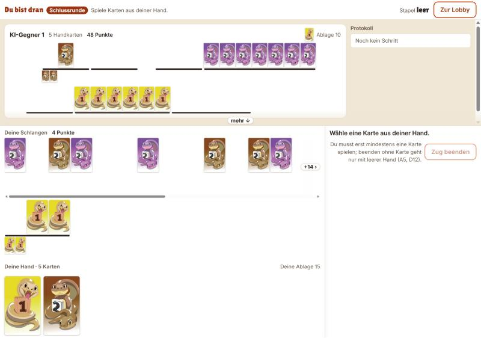
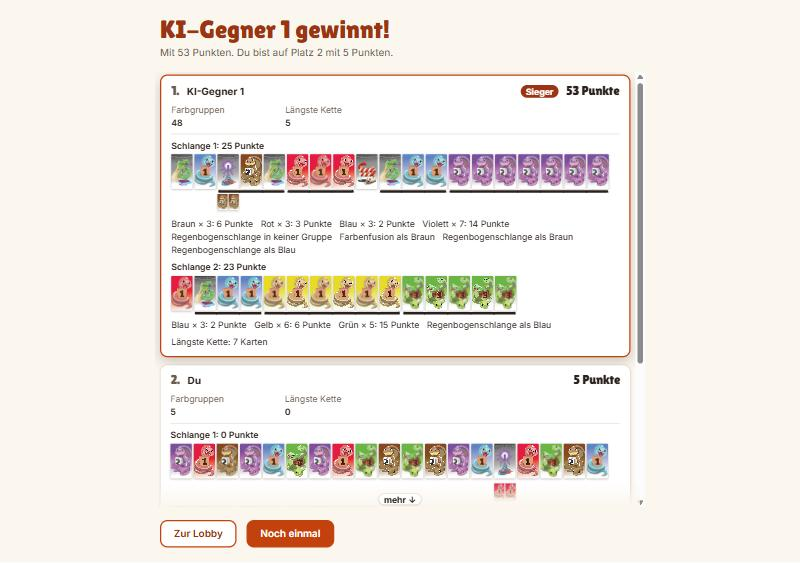

# Prüfprotokoll Z1 – Vollpartien im Browser (Basis-Teil für M2)

| Feld | Wert |
|---|---|
| Task | Z1 Vollpartien im Browser, Basis-Teil für M2 |
| Branch | `task/Z1-vollpartien`, PR #123 gegen `neuaufbau` |
| Geprüfter Stand | `2ad2cfde` (Basis `ab254461`, `origin/neuaufbau` steht auf `ab254461`) |
| Prüfer | Claude Code (Opus 5.5) als unabhängiger Prüfer, eigener Worktree, ohne Kenntnis des Umsetzerberichts; den PR nur für die Dateibegründungen gelesen |
| Iteration | 1 |
| Datum | 27.11.2026 |
| Umgebung | Windows 11 Pro 10.0.26300, Node v25.2.1, npm 11.5.2, Python 3.13.15, Playwright 1.60.0 |

Vorbereitung: Nach dem Auschecken hatten 408 Dateien CRLF; alle getrackten Dateien gelöscht und neu ausgecheckt, danach 0. `core.hooksPath` zeigt auf `scripts/githooks`. `npm ci` Exit 0. Logs und Belege unter `<scratchpad>/Z1-pruefer/`.

## Urteil: ABGENOMMEN

Die vier Basis-Läufe spielen über echte Klicks und Taps ganze Partien im Produktionsbuild bis zur Wertung und prüfen nach jedem einzelnen Schritt Konsole, Quelltext und Schrittkette; die angezeigte Wertung stimmt mit der Engine und mit meiner eigenen Partie im eingebauten Browser überein. Kriterium 3 ist vorbereitet, der Lauf gegen die Vorschau steht beim Nutzer aus; das ist nach dem Entscheid des Orchestrators für M2 kein Mangel. Mängel: keine. Hinweise für M3 stehen am Ende.

## Abnahmekriterien

| # | Kriterium (wörtlich aus dem Plan) | erfüllt | Kernbeleg |
|---|---|---|---|
| 1 | Ein Playwright-Lauf spielt als Mensch über echte Klicks ganze Partien bis zur Wertung: Basis und Erweiterung, je zu zweit und zu viert, je auf Desktop und Handy (8 Läufe, feste Saaten). | ja (Basis, 4 von 8; die 4 Erweiterungs-Läufe sind angelegt und lassen sich einschalten) | `npm run test:vollpartien` Exit 0, 4 passed, drei Läufe; Produktionsbuild byte-gleich mit `npm run build` |
| 2 | Kein Konsolenfehler; die angezeigte Endwertung stimmt mit der Engine überein; nach keinem Schritt steht eine fremde Handkarte im Seitenquelltext. | ja | Prüfung nach jedem Schritt im Code gelesen; vier eigene Gegenproben im App-Code, alle rot mit passender Meldung |
| 3 | Der Lauf ist gegen die Vercel-Vorschau wiederholbar. | vorbereitet, Lauf durch den Nutzer ausstehend | `Z1_BASIS_URL`, `Z1_VERCEL_SCHUTZ`, Kopf `x-vercel-protection-bypass`, Doku, `.env.example` ohne Werte, kein Geheimnis im Repo |

### 1. Ganze Partien über echte Klicks

**Was der Lauf tut (am Code gelesen).** `tests/vollpartien/vollpartie.spec.ts` öffnet die Lobby, wählt die Gegnerzahl über den Text „3 Gegner“ (Tippen auf dem Handy, `bedienung()` nimmt `tap()` bei `hasTouch`), klickt „Neue Partie“ und spielt dann, bis `partiephase` „Beendet“ ist. Der Mensch (`tests/vollpartien/mensch.ts`) bedient nur Locatoren der Oberfläche: Dialog „Zu viele Handkarten“, Abwehrfrage, Handkarten, Ziele (`[data-ziel][aria-pressed="false"]`), „Ausführen“, „Abbrechen“, „Zug beenden“. Die Engine ruft er nicht auf; den gespeicherten Stand liest er nur, um die Farbe an den Schlangenenden zu kennen, die er auch auf dem Tisch sieht. Der Lauf selbst nutzt die Engine nur zum Prüfen (`ermittleEntscheider` für die Schleife, `schrittZwischen`, `berechneEndwertung`), nie zum Spielen. Die KI-Gegner spielen ihre Züge in der App selbst.

**Produktionsbuild.** Ohne `Z1_BASIS_URL` baut die Konfiguration mit `vite build --outDir dist-vollpartien` und `VITE_TEST_HOOKS: '0'` und startet `vite preview` auf Port 4175. Die Bundles in `dist-vollpartien/assets` haben dieselben SHA-256-Prüfsummen wie die von `npm run build` in `dist/assets` (`index-DPliFSc8.js` `ea17188d…`, `prod-GCWOFV5q.js` `0a1e3382…`), „Entwicklertisch“ kommt in keinem Bundle vor. Gespielt wird also genau der ausgelieferte Build.

**Fester Zufall und angehaltene Uhr: zulässig.** Die App zieht Zufall nur aus `Math.random`: die Lobby mischt mit `erstellePartie({ …, zufall: Math.random })` (`src/ui/lobby/partie.ts:44`), die KI-Gegner ziehen ihre Saaten in `erstelleGegner` (`src/ui/spiel/useSpiel.ts:96`). `bereiteSeiteVor` ersetzt `Math.random` vor dem Laden durch Mulberry32 aus der Saat, mit Werten in [0, 1) wie das Original, und zählt die gezogenen Werte. Der Quellcode der App bleibt unverändert, nur die Quelle des Zufalls ist fest; das ist eine übliche Testtechnik und verfälscht keinen Ablauf. Die Uhr steht mit `page.clock` still, und der Lauf stellt sie je KI-Schritt um `KI_PAUSE_WENIGER_BEWEGUNG` (100 ms) vor. Damit feuert genau der Zeitgeber, den die App für den KI-Schritt setzt; die Reihenfolge der Ereignisse ist dieselbe wie mit echter Zeit, nur wird nach jedem KI-Schritt geprüft. Dass beides stimmt, belegt meine Browserpartie: Mit demselben Zufall nach drei vorgezogenen Werten startete der Produktionsbuild ohne angehaltene Uhr mit genau den Händen des Laufs (unten, Browserprüfung). Einschränkung: Weil die Projekte mit „weniger Bewegung“ laufen, wird nur die 100-ms-Pause gespielt, nicht die normale von 700 ms. Das ist dokumentiert und für das Kriterium unerheblich.

**Läufe.** Drei Läufe auf `2ad2cfde`, Port 4175 vorher und nachher ohne lauschenden Socket:

| Lauf | Exit | Ergebnis | Wandzeit |
|---|---|---|---|
| `npm run test:vollpartien` (1, `vollpartien-1.txt`) | 0 | 4 passed (2.0 m) | 2 min 10 s samt Bau, parallel zu anderen Agenten |
| `--reporter=json` (2, `vollpartien-2.json`) | 0 | 4 passed | rund 50 s |
| `--reporter=json` (3, `vollpartien-3.json`) | 0 | 4 passed, `duration` 32,6 s | 36 s samt Bau |

| Projekt | Lauf | Schritte (davon du) | Endwertung (Annotation `Z1`) |
|---|---|---|---|
| desktop | Basis zu zweit, Saat 2026 | 186 (96) | Du 5, KI-Gegner 1 53 (Sieger) |
| desktop | Basis zu viert, Saat 13 | 173 (43) | Du 3, KI-Gegner 1 16 (Sieger), KI-Gegner 2 6, KI-Gegner 3 16 (Sieger) |
| handy-hochkant | Basis zu zweit, Saat 2026 | 186 (96) | wie Desktop |
| handy-hochkant | Basis zu viert, Saat 13 | 173 (43) | wie Desktop |

Läufe 2 und 3 sind in Schritten und Endwertung gleich. Mein Mitschnitt aller gespeicherten Stände (Grenzfall 1) zeigt, dass die Partien Stand für Stand gleich sind. Gespielt wurden FarbkarteLegen, ZugBeenden, Reagieren, VerdopplerSpielen, FusionLegen, SchlangenfrassSpielen, FarbendiebSpielen, BlockadeLegen, RegenbogenschlangeLegen, SchlangengrubeSpielen und SonderkarteWirkungslosAblegen; zu viert endet die Partie im Gleichstand zweier Sieger (D22).

**Erweiterung.** Die Läufe stehen in `LAEUFE` mit `wartetAuf: 'O10'` und werden über `LAEUFE.filter(({ wartetAuf }) => wartetAuf === null)` gar nicht erst angelegt; kein `test.skip` (`check:regeln` grün). Zum Einschalten genügt `wartetAuf: null`: Ich habe es probeweise getan (Grenzfall 3), beide Läufe liefen schon auf diesem Stand grün.

### 2. Konsole, Endwertung, fremde Handkarten

**Am Code.** `beobachteKonsole` sammelt jede Meldung der Art `error` und jedes `pageerror`. `pruefeSeite` läuft nach dem Start, nach jedem Klick des Menschen (`nachKlick` auch nach dem letzten), nach jedem KI-Schritt und auf der Wertung. Sie wartet zwei Runden über `MessageChannel`, bis React gezeichnet hat, prüft an der Zahl der Handkarten jedes Spielers, dass die Seite den gespeicherten Stand zeigt, verlangt eine leere Fehlerliste und ruft `verrateneIds(zustand, await page.content())` auf: fremde Handkarten und fremde geheime Aufgaben als ganze Wörter im HTML samt Attributen. `schrittZwischen` verlangt, dass jeder neue Stand aus dem vorigen durch genau eine Aktion entsteht, die `ermittleAktionen` aufzählt; der erste Stand muss die Partie der Saat sein. `pruefeWertung` vergleicht je Spieler Summe, Farbgruppen, Kettenbonus, Platz, Sieger-Abzeichen und den Namen im Titel mit `erwarteteWertung`, die Platz und Sieger selbst aus `berechneEndwertung` ableitet, nicht über `ergebnisAnsicht` der Oberfläche.

**Gegenproben** (siehe Abschnitt Gegenprobe): falscher Platz bei Gleichstand, fremde Karte im Attribut (ab Start und erst ab Spielmitte), zwei Schritte in einem gespeicherten Stand und ein ungefangener Wurf auf der Wertung. Alle vier wurden rot, jede mit der passenden Meldung und am passenden Schritt.

**Browser.** Die Wertung, die ich im eingebauten Browser selbst herbeigeführt habe, zeigt KI-Gegner 1 mit 53 (48 und 5) und dich mit 5 (5 und 0), wie der Lauf berichtet; der gespeicherte Schlussstand ist byte-gleich mit dem Schlussstand des Laufs. Keine Konsolenfehler (nur zwei Warnungen des Browserfensters zum Permissions-Policy-Kopf).

### 3. Vercel-Vorschau

Nach dem Entscheid des Orchestrators lief kein Lauf gegen eine Vorschau, und ich habe kein Geheimnis angefasst. Geprüft am Code und mit Tests:

- `playwright.vollpartien.config.ts`: `Z1_BASIS_URL` setzt `baseURL` und schaltet den eigenen Server ab; eine Angabe, die keine Adresse ist, bricht mit Meldung ab; ein Schrägstrich am Ende wird entfernt. `Z1_VERCEL_SCHUTZ` geht als `extraHTTPHeaders` `x-vercel-protection-bypass` mit, dazu `x-vercel-set-bypass-cookie: true`; ohne Variable gibt es keinen Kopf. `tests/vollpartien.test.ts` hält alle drei Fälle fest (in `npm test` grün).
- Der Lauf braucht auf der Vorschau keine Testhooks, weil der feste Zufall über `Math.random` kommt.
- `docs/WORKFLOW.md`, Abschnitt „Vollpartien im Browser (Z1)“, beschreibt Saaten, Prüfungen, Port 4175 und den Aufruf gegen die Vorschau in PowerShell und sagt ausdrücklich, dass der Lauf gegen eine echte Vorschau noch nicht gelaufen ist. `AGENTS.md` nennt `npm run test:vollpartien` unter „Befehle“.
- `.env.example` nennt beide Namen ohne Wert. `git grep -i -E "x-vercel|Z1_VERCEL_SCHUTZ|protection.bypass"` findet nur Namen, Doku und den Testwert `geheim` in `tests/vollpartien.test.ts`; `regelcheck.py` meldet kein Secret.

Erfüllt ist damit „vorbereitet“; ob der Lauf gegen die Vorschau wirklich wiederholbar ist, zeigt erst der Lauf des Nutzers.

## Gates

Jeder Befehl einzeln, Exit-Code einzeln gelesen (Git Bash `${PIPESTATUS[0]}` hinter `tee`), Logs unter `<scratchpad>/Z1-pruefer/`:

| Befehl | Exit | gekürzte Ausgabe |
|---|---|---|
| `npm test -- --run` | 0 | Test Files 194 passed, Tests 3261 passed (408 s) |
| `npm run typecheck` | 0 | `tsc -b` ohne Ausgabe |
| `npm run build` | 0 | `prod-GCWOFV5q.js 448.15 kB`, built in 1.69 s |
| `npm run check:test-lines` | 0 | Alle Testdateien bleiben unter 500 Zeilen. |
| `npm run check:css-asserts` | 0 | 0 in 0 Dateien (Baseline gehalten) |
| `npm run check:regeln` | 0 | verglichen mit origin/neuaufbau (Merge-Basis ab25446), keine Verstösse |
| `npx eslint .` | 0 | ohne Ausgabe |
| `python scripts/regelcheck.py` | 0 | 7 Warnungen, keine Fehler (BOM in drei alten Belegen samt Kopien, `tests/layout/messung.ts` 934 Zeilen; alles Altbestand) |
| `npm run test:layout` | 0 | 2405 passed (6.5 m), danach lauscht auf 4173 und 4174 nichts |
| `npm run test:vollpartien` | 0 | 4 passed, dreimal (siehe Kriterium 1) |

Ports: Vor `test:vollpartien` und `test:layout` lauschte auf 4173, 4174 und 4175 nichts (`netstat -ano | grep -E ':417[345] ' | grep -E 'LISTENING|ABH'` ohne Ausgabe). `test:layout` und `test:vollpartien` stören sich nicht: Der Vollpartie-Lauf nutzt nur 4175, und `playwright.config.ts` sammelt `tests/vollpartien` nicht ein (`testDir: './tests/layout'`, im Vitest-Test festgehalten).

## Erster Commit

`git log --oneline --reverse origin/neuaufbau..HEAD`:

```
a9b1e07a test: Z1 Vollpartien im Browser, Läufe und Prüfungen vor der Umsetzung
320dcbd0 feat: Z1 Vollpartien im Browser für die vier Basis-Läufe
b8f4d517 refactor: Z1 nach /simplify, vorhandene Prüfhelfer statt eigener Kopien
2ad2cfde docs: Z1 Laufzeit gemessen unter Last nachgetragen
```

`a9b1e07a` enthält nur `tests/vollpartien.test.ts` und `tests/vollpartien/vollpartie.spec.ts`. Auf diesem Commit: `npx vitest run tests/vollpartien.test.ts` Exit 1 mit „Cannot find module './vollpartien/pruefung'“, `npx playwright test --config playwright.vollpartien.config.ts` Exit 1 mit „playwright.vollpartien.config.ts does not exist“. Rot, weil die Prüfhilfen und die Konfiguration fehlen, nicht wegen eines Tippfehlers. Spätere Commits haben die Tests umgebaut: Die eigene Id-Suche wich `verrateneIds` (die zusätzlich fremde geheime Aufgaben findet), der Startstand wird neu gegen die Partie der Saat geprüft, die Saat zu viert wechselte von 1125 auf 13 (kommentiert: Gleichstand zweier Sieger und Punkte für dich). Schwächer wurde dadurch nichts.

## Diff gegen das Feld „Dateien“

`git diff --stat origin/neuaufbau...HEAD`:

```
 .env.example                         |   4 +
 .gitignore                           |   2 +
 AGENTS.md                            |   4 +
 docs/WORKFLOW.md                     |  59 +++++++++++++
 package.json                         |   1 +
 playwright.vollpartien.config.ts     |  70 +++++++++++++++
 tagebuch/tests/bereiche.md           |   1 +
 tagebuch/website/.stand              |   2 +-
 tagebuch/website/tests.html          |   5 +-
 tests/vollpartien.test.ts            | 141 ++++++++++++++++++++++++++++++
 tests/vollpartien/mensch.ts          | 161 +++++++++++++++++++++++++++++++++++
 tests/vollpartien/pruefung.ts        |  72 ++++++++++++++++
 tests/vollpartien/seite.ts           | 137 +++++++++++++++++++++++++++++
 tests/vollpartien/vollpartie.spec.ts | 143 +++++++++++++++++++++++++++++++
 tsconfig.layout.json                 |   2 +-
 tsconfig.test.json                   |   2 +-
 16 files changed, 801 insertions(+), 5 deletions(-)
```

Z1 hat im Plan kein Feld „Dateien“; jede Datei braucht deshalb eine Begründung. Der PR begründet alle:

| Datei | im Feld | Urteil |
|---|---|---|
| `tests/vollpartien/*.ts`, `tests/vollpartien.test.ts`, `playwright.vollpartien.config.ts` | – | der Lauf selbst, trägt |
| `package.json` | – | nur das Skript `test:vollpartien`, keine Abhängigkeit (U10), trägt |
| `tsconfig.layout.json`, `tsconfig.test.json` | – | `tests/vollpartien` braucht DOM-Typen wie `tests/layout`; trägt |
| `.gitignore` | – | `dist-vollpartien` (Zeile 16), trägt |
| `.env.example` | – | Namen ohne Wert für K3, trägt |
| `AGENTS.md`, `docs/WORKFLOW.md` | – | Befehl und Abschnitt „Vollpartien im Browser“, trägt |
| `tagebuch/tests/bereiche.md`, `tagebuch/website/*` | – | neuer Bereich `VOLL` und neu gebaute Seite, trägt |

Nichts unter `src/`. U9: keine neue Datei trägt einen Kopf mit Author, Datum oder Version oder einen `ÄNDERUNG`-Kommentar. U11: kein Code aus Altprojekten erkennbar. U13: keine der geschützten Dateien berührt. Abweichung vom Auftrag laut PR: Standardziel ist der Produktionsbuild statt des Testhook-Builds; das ist begründet und für das Kriterium besser.

## Gegenprobe

Je ein Eingriff in den Code der App (nie in eine Testdatei), danach `git checkout -- <datei>` und `git status` leer. Diffs und Ausgaben stehen in `<scratchpad>/Z1-pruefer/Z1-gegenprobe-*.txt`. Der Umsetzer hatte Fehler in Konsole, DOM und Seitenquelltext von aussen eingeschleust; meine Eingriffe sitzen in der App selbst.

| # | Datei, Eingriff | Befehl | Exit | Meldung |
|---|---|---|---|---|
| 1 | `src/ui/spiel/ergebnisAnsicht.ts:55`: Gleichstand bricht nach `spielerId`, statt beiden Platz 1 zu geben | `--project desktop` | 1 | zu viert: „Wertung von KI-Gegner 3: Platz“, erwartet „1.“, erhalten „2.“; zu zweit grün (kein Gleichstand) |
| 2 | `src/ui/spiel/tischAnsicht.ts` und `src/ui/tisch/Gegner.tsx`: `data-pruefer` mit der ersten Sonderkarte aus der Hand eines Gegners | `--project desktop` | 1 | beide: „Z1 nach dem Start: Verborgene Karten im Seitenquelltext“, etwa `farbenfusion-02` |
| 3 | wie 2, aber die letzte Handkarte und erst, wenn der Stapel unter 50 Karten hat | `--project handy-hochkant` | 1 | „Z1 Schritt 92 (Spieler 1), Zug beenden: Verborgene Karten …“ (`regenbogenschlange-01`) und „Schritt 74 …“ (`braun-07`, `gruen-09`, `violett-08`) |
| 4 | `src/ui/spiel/useSpiel.ts` in `spiele`: nach „FarbkarteLegen“ eines KI-Gegners gleich dessen „ZugBeenden“ anwenden und nur das Ende speichern | `--project desktop` | 1 | „Z1: Keine der 13 Aktionen, die die Engine im vorigen Stand aufzählt, führt zum gespeicherten neuen Stand.“ (zu viert: 11) |
| 5 | `src/ui/ergebnis/Ergebnis.tsx`: `useEffect` mit `queueMicrotask(() => { throw … })` | `--project handy-hochkant` | 1 | „Z1 Schritt 186 (Spieler 1), Zug beenden: Konsolenfehler“, „Ungefangen: Gegenprobe Z1: Wurf nach der Wertung“; zu viert nach Schritt 173 |

Die Prüfungen schlagen also bei falscher Wertung, Verrat mitten in der Partie, übersprungenem Zwischenstand und Fehler nach dem letzten Schritt an.

## Browserprüfung

Z1 ändert keine Oberfläche; geprüft wird, ob die Partie des Laufs im echten Browser genauso aussieht. Produktionsbuild aus `dist-vollpartien` (byte-gleich mit `npm run build`), eigener Server `npx vite preview --outDir dist-vollpartien --port 4176 --strictPort`, Adresse `http://localhost:4176/`, eingebauter Browser bei 1280×900. Seine Bildschirmfotos sind auf die Breite des Fensters verkleinert (800 px, das erste 480 px).

**Start.** In der Lobby habe ich `Math.random` durch Mulberry32 mit Saat 2026 ersetzt und drei Werte vorgezogen (so viele zählt der Lauf beim Laden), dann „Neue Partie“ geklickt. Die Hände im Speicher waren genau die des Laufs: du `braun-08 verdoppler-03 braun-04 gelb-07 violett-12`, KI-Gegner 1 `blau-06 violett-04 blau-14 violett-06 farbenfusion-02`. Danach habe ich wie der Lauf die erste Braun 2 in eine neue Schlange gelegt; der Stand stimmte mit Schritt 1 des Mitschnitts überein.



`bilder/Z1-start-zu-zweit-eingebauter-browser.png`: Spieltisch, oben „Du bist dran“ und „Stapel 98“, KI-Gegner 1 mit 5 Handkarten und 0 Punkten, „Noch keine Schlange“, das Protokoll „Noch kein Schritt“. Unten deine Hand mit fünf Karten: Braun 2, Verdoppler, Braun 2, Gelb 1, Violett 2. Rechts „Wähle eine Karte aus deiner Hand“ und „Zug beenden“ ausgegraut mit Grund. Nichts abgeschnitten.

**Bis zur Wertung.** Die 183 Schritte dazwischen habe ich nicht von Hand nachgespielt. Ich habe den Stand nach Schritt 184 von 186 aus meinem Mitschnitt in den Speicher gelegt, in der Lobby „Weiterspielen“ geklickt und die letzten zwei Schritte des Menschen selbst gemacht: Gelb 1 an „Deine Schlange 2: Ende“, „Ausführen“, „Zug beenden“.



`bilder/Z1-schlussrunde-zu-zweit-eingebauter-browser.png`: Kopf „Du bist dran“, rotes Abzeichen „Schlussrunde“, „Stapel leer“. KI-Gegner 1 hat 5 Handkarten und 48 Punkte, zwei Schlangen, Ablage 10. „Deine Schlangen 4 Punkte“: eine lange Schlange mit „+14 ›“ und waagrechtem Bildlauf innerhalb der Schlange, darunter die zweite mit zwei gelben Karten auf einer Fusion. Deine Hand: Gelb 1 und Braun 2 sichtbar, weitere unter dem Rand. Plausibel für das Ende einer Partie.



`bilder/Z1-wertung-zu-zweit-eingebauter-browser.png`: Titel „KI-Gegner 1 gewinnt!“, darunter „Mit 53 Punkten. Du bist auf Platz 2 mit 5 Punkten.“ Platz 1 KI-Gegner 1 mit Abzeichen „Sieger“ und 53 Punkten, Farbgruppen 48, Längste Kette 5, Schlange 1 mit 25 und Schlange 2 mit 23 Punkten samt Gruppen (Violett × 7: 14 Punkte, Grün × 5: 15 Punkte). Platz 2 „Du“ mit 5 Punkten. Knöpfe „Zur Lobby“ und „Noch einmal“. `get_page_text` las für dich Farbgruppen 5, Längste Kette 0 und „Gelb × 4: 5 Punkte“. Das ist genau die Endwertung, die der Lauf meldet. Der gespeicherte Schlussstand hat dieselbe SHA-256-Prüfsumme wie der des Laufs (`659617d4…`, 8'381 Byte). `scrollWidth` 1280 = `clientWidth` 1280. Konsole: keine Fehler, nur zwei Warnungen des Fensters zu `join-ad-interest-group` und `run-ad-auction` im Permissions-Policy-Kopf. Netzwerk: nur `localhost:4176`.

**Dieselbe Wertung auf Handy und Desktop mit Playwright** (Skript `<scratchpad>/Z1-pruefer/wertung-handy.mjs`, Geräteklassen aus `scripts/pruefung/geraeteklassen.mjs`, „Ergebnis ansehen“ in der Lobby mit `tap()` auf dem Handy):

`bilder/Z1-wertung-zu-zweit-handy-hochkant.png` (390×844, Touch): Titel „KI-Gegner 1 gewinnt!“ in zwei Zeilen, Unterzeile umbrochen. Karte von KI-Gegner 1 mit „Sieger“ und „53 Punkte“ in einer Zeile, Farbgruppen 48, Längste Kette 5; die Schlangen laufen waagrecht mit „+10 ›“ und „+6 ›“, die Gruppenzeilen umbrechen sauber. Darunter beginnt „2. Du 5 Punkte“, „mehr ↓“ zeigt, dass es weitergeht. „Zur Lobby“ und „Noch einmal“ unten. `scrollWidth` 390 = `clientWidth` 390, 0 Konsolenfehler. Beim ersten Bild fehlten noch zwei blaue Karten, weil die Bilder nicht geladen waren; nach dem Warten auf geladene Bilder sind alle Karten da.

`bilder/Z1-wertung-zu-zweit-desktop.png` (1280×900): wie im eingebauten Browser, alle Karten beider Schlangen von KI-Gegner 1 sichtbar, darunter deine Schlange 1 mit 0 Punkten. `scrollWidth` 1280 = `clientWidth` 1280, 0 Konsolenfehler.

Tablet und Handy quer entfallen: Z1 verlangt Desktop und Handy, und die Oberfläche ist unverändert (die Layout-Verträge aller fünf Klassen laufen in `test:layout`).

Server danach beendet: zweimal `vite preview` auf 4176 (PID 67404 und 4292, Befehlszeile jeweils `…\worktrees\agent-a32d8750fa074e611\node_modules\.bin\\..\vite\bin\vite.js preview --outDir dist-vollpartien --port 4176 --strictPort`), danach lauscht auf 4173 bis 4176 nichts. Den Tab des eingebauten Browsers habe ich geschlossen. Die Hilfsdatei mit dem Stand lag nur vorübergehend in `dist-vollpartien` und ist gelöscht.

## Satz-für-Satz-Abdeckung

Entfällt, weil Z1 kein Engine-Task ist.

## Eigene Grenzfälle

1. **Gleich Stand für Stand, nicht nur gleiche Endwertung.** Eine gleiche Endwertung könnte zufällig entstehen. Ich habe eine vorübergehende Spec neben `vollpartie.spec.ts` gelegt, die dieselbe Schleife mit denselben Hilfen spielt und nach jedem Schritt `serialisiere(neu)` samt Art der Aktion in eine JSON-Datei im Scratchpad schreibt, danach gelöscht. Ergebnis: Desktop und Handy hochkant haben je Partie dieselbe Prüfsumme (zu zweit `ee043a0d…`, 186 Schritte; zu viert `2e99cc71…`, 173 Schritte), und die Endwertung daraus stimmt mit dem Lauf überein. Dazu Läufe 2 und 3 mit gleichen Annotationen.
2. **`VITE_TEST_HOOKS=1` in der Umgebung.** Wer die Variable von einem anderen Lauf gesetzt hat, soll trotzdem den Produktionsbuild spielen. `VITE_TEST_HOOKS=1 npx playwright test --config playwright.vollpartien.config.ts --project desktop -g "zu zweit"`: Exit 0, Bundles byte-gleich mit `dist/`, „Entwicklertisch“ 0-mal im Bundle. Die Konfiguration überschreibt die Variable wie im Kommentar behauptet.
3. **Erweiterungs-Läufe vorzeitig eingeschaltet.** Beide Zeilen probeweise auf `wartetAuf: null` gesetzt, danach zurückgesetzt. „Erweiterung zu zweit“ (Saat 3101) auf Desktop grün in 1.2 min; „Erweiterung zu viert“ (Saat 3103) auf Desktop und Handy grün, je 180 Schritte (45 von dir), „Du 22 (Sieger), KI-Gegner 1 16, KI-Gegner 2 22 (Sieger), KI-Gegner 3 9“. Für M3 genügt also das Einschalten; siehe aber Hinweis 1 und 2.

## Testregister

Bereich `VOLL` (`tests/vollpartien/**, tests/vollpartien.test.ts, playwright.vollpartien.config.ts`), vom Umsetzer vorgeschlagen: passend und eng genug. Ergänzt habe ich `.env.example` im Bereich `BUILD`; ohne Bereich hätte jede Änderung daran alle Läufe entwertet (Vorschlag an den Orchestrator). Danach meldet die Zuordnung des Diffs „Bereiche: BUILD, PRUEF, VOLL, Ohne Bereich: keine“. Ein Tagebucheintrag zu Z1 fehlt, deshalb ohne `--eintrag`.

| Testfall | Inhalt | Lauf | Status |
|---|---|---|---|
| TF-VOLL-001 | Vier Basis-Läufe grün mit den gemeldeten Endwertungen | `2026-11-27-1419-TF-VOLL-001` | bestanden |
| TF-VOLL-002 | Grenzfall: dieselben Partien Stand für Stand | `2026-11-27-1419-TF-VOLL-002` | bestanden |
| TF-VOLL-003 | Wertung im Produktionsbuild gleich der des Laufs | `2026-11-27-1419-TF-VOLL-003` | bestanden |
| TF-VOLL-004 | Grenzfall: `VITE_TEST_HOOKS=1` gesetzt | `2026-11-27-1419-TF-VOLL-004` | bestanden |
| TF-VOLL-005 | Prüfungen schlagen bei vier eingebauten Fehlern an; Vorschau vorbereitet ohne Geheimnis | `2026-11-27-1419-TF-VOLL-005` | bestanden |

## Hinweise (kein Mangel)

1. **Für M3: Erweiterungs-Posten einzeln vergleichen.** `pruefeWertung` prüft Summe, Farbgruppen, Kette, Platz und Sieger, aber nicht die Posten „Vielfalt“ und „Aufgaben“, die es nur mit Erweiterung gibt (`posten-vielfalt`, `posten-aufgaben`). Die Summe deckt sie nur gemeinsam ab.
2. **Für M3: Saaten der Erweiterung.** Mit Saat 3101 und 3103 laufen die Erweiterungs-Läufe schon jetzt, ohne O10, grün. Der Kommentar in `vollpartie.spec.ts` sagt, ohne O10 könne der Mensch die Entscheidungen der Erweiterung nicht bedienen; offenbar treten sie in diesen Partien nicht auf. Für M3 sollte belegt sein, dass die gewählten Saaten die Entscheidungen aus O10 wirklich erreichen, sonst prüfen die Läufe sie nicht.
3. **`Z1_VERCEL_SCHUTZ` ohne `Z1_BASIS_URL`.** Dann geht der Kopf auch an den eigenen Server auf localhost. Harmlos, aber der Kopf liesse sich auf den Fall `basis !== null` beschränken.
4. **Verrat nur über Ids.** `verrateneIds` findet Ids, nicht Kartennamen. Ein Fehler, der eine fremde Karte nur als „Farbkarte Rot, 1 Punkt“ zeigt, fiele nicht auf. Das gilt genauso für `tests/layout/tisch.spec.ts` und ist dort die vereinbarte Prüfung.
5. **Laufzeit.** Ohne Last 36 s samt Bau, beim ersten Lauf parallel zu anderen Agenten 2 min 10 s. `docs/WORKFLOW.md` nennt 35 bis 55 Sekunden, `AGENTS.md` „unter einer Minute“; unter starker Last stimmt das nicht ganz.
6. `docs/WORKFLOW.md` nennt in der Tabelle die Erweiterungs-Läufe „noch nicht angelegt“; im Code stehen sie als Zeilen mit `wartetAuf`. Gemeint ist, dass keine Tests daraus entstehen; das passt, könnte aber deutlicher dastehen.
